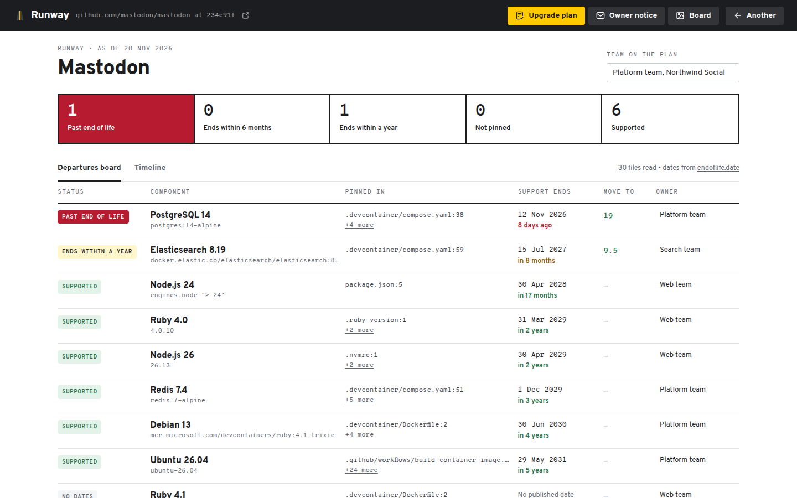
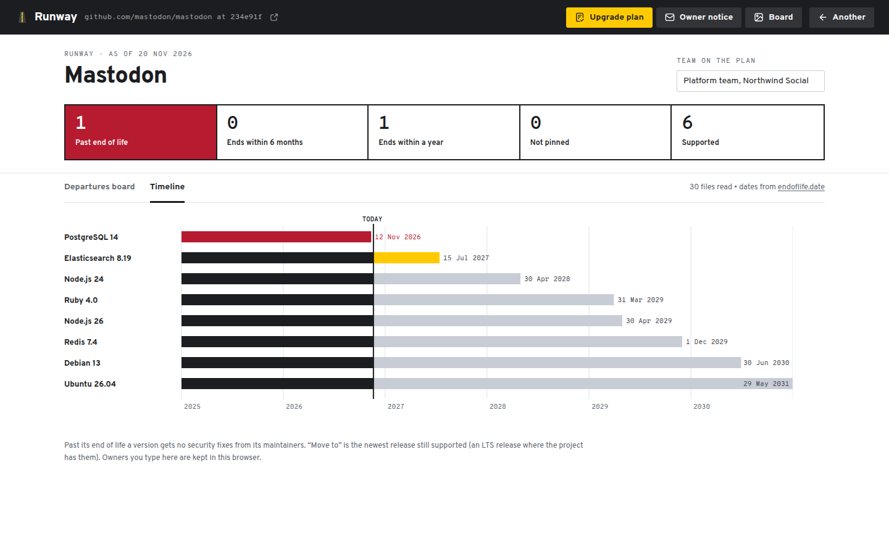
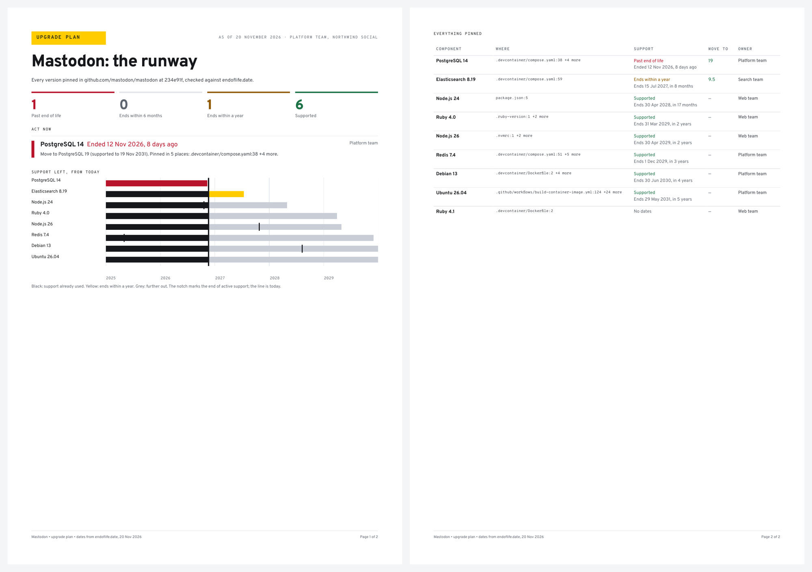
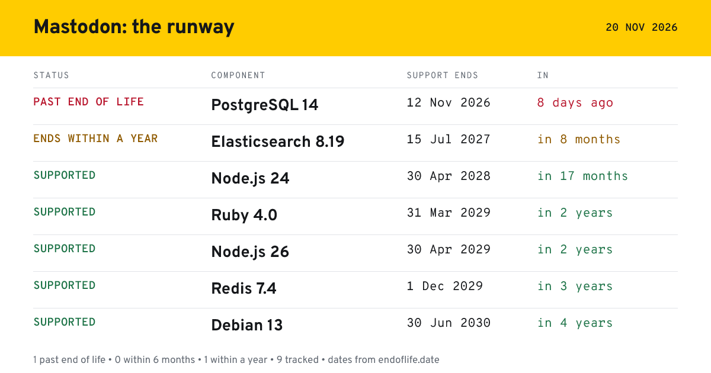
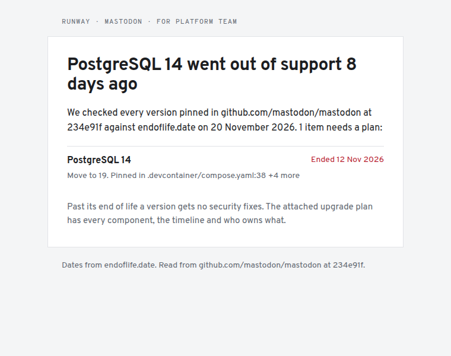

# Runway

**How long each part of your stack has left.** Paste a public GitHub repository. Runway finds every version your
code pins (Node, Python, Ruby, Go, Postgres, Redis, Elasticsearch, Debian, Ubuntu, Alpine and more), checks each one
against [endoflife.date](https://endoflife.date), and writes three things:

- an upgrade plan (PDF) with the timeline
- an end-of-life notice email for each owner
- a board card (PNG) for the team channel

Built with [Hyper Elements](https://github.com/hyper-elements/hyper-elements) for the Hyper Elements Template Challenge.



## Why this exists

From [r/devops, October 2026](https://old.reddit.com/r/devops/comments/1x8ubmw/), "How does your team track
everything that's about to be retired in your cloud?":

> "Each cloud sends its own notices, but they tend to land with account or subscription owners, not the team that
> owns the workload. And unlike library versions, none of this shows up in Renovate or Dependabot."

> "We realise it's broken when loads of tickets start coming in."

> "What worked for me is pulling the inventory from the code instead of the inbox: pinned versions in Terraform and
> CI, runtime versions, and database versions, each with an owner"

Runway does exactly that last part.

**A real example.** PostgreSQL 14 reached end of life on 12 November 2026. On 20 November, Mastodon
([github.com/mastodon/mastodon](https://github.com/mastodon/mastodon), commit `234e91f`) still pinned
`postgres:14-alpine` in five places: `docker-compose.yml`, the dev container, and three test jobs in
`.github/workflows/test-ruby.yml`. Runway found all five from the repository link.

## How it works

| Step | What happens |
|---|---|
| **Scan** | Paste a public GitHub repository (or a `/tree/branch` link), upload files, or upload an inventory CSV for what isn't in code (a managed database, a cluster). |
| **Check** | Each pinned version is matched to its release cycle on endoflife.date (`14` → 14, `3.12.4` → 3.12, `7` → the newest 7.x). Rows that land on the same release merge, with every place listed. |
| **Assign** | Type an owner on each row. Owners are remembered in your browser for that project. |
| **Send** | Preview and download the upgrade plan, the notice (for one owner or everyone) and the board. |

Status: **past end of life**, **ends within 6 months**, **ends within a year**, **supported**, **not pinned** (an
image with no version, which changes major version the day it's rebuilt), or **no dates** (endoflife.date doesn't
list that release yet). "Move to" is the newest supported release, or the newest LTS release for products that have
LTS.



The upgrade plan (A4): what to act on, the counts, the timeline, then every component.



| Board (PNG) | Owner notice |
|---|---|
|  |  |

The landing page (7 sections with an FAQ): [media/landing.png](media/landing.png). The dashboard on a phone:
[media/mobile.png](media/mobile.png).

## What it reads

| File | What |
|---|---|
| `.nvmrc`, `.node-version` | Node.js |
| `.python-version`, `.ruby-version` | Python, Ruby |
| `.tool-versions` | every tool asdf/mise pins |
| `go.mod` | the `go` line |
| `package.json` | `engines.node` |
| `Dockerfile*` | `FROM` images with `ARG` defaults resolved, build stages skipped, the OS in the tag (`-bookworm`, `-alpine3.20`) |
| `compose*.yml` | `image:` lines (commented lines skipped) |
| `.github/workflows/*.yml` | `node-version`, `python-version`, `runs-on: ubuntu-XX.XX`, service images |
| inventory CSV | `component, version, owner, where` ([sample](public/samples/inventory-format.csv)) |

A scan of a public repository uses three GitHub API requests (GitHub allows 60 an hour without a token); the files
come from `raw.githubusercontent.com`. Everything runs in the browser.

## How Hyper Elements is used

The three outputs are **Hyper Elements templates** in `templates/`. The app renders them in a route handler
(`src/app/api/render/route.ts`), and the CLI renders the same files.

- **Typed fields with rules** (`templates/_shared/doc.tsx`): 1 to 80 items, each with a `status` that must be one of
  six values, dates that must be dates, and a count of places that must be a whole number. A value outside the rules
  stops the render with the field and the reason (the API answers 422).
- **`<Document>` + `renderPdf()`** for the plan. The timeline is a `Layer`: an `Svg` of `Rect`/`Line` bars on a shared
  axis, with the labels laid over it. Then a paged `Table` with `PageBreak`, `PageFooter` and `PageNumber`.
- **`<Canvas>` + `renderImage()`** for the 1200 × 630 board, with `image/overflow`, `image/glyph` and `image/fit`
  required. The overflow rule caught a real 6 px spill at the bottom while we built it.
- **`<Email>`** with a `defineTheme()` theme, checked by lint (`lang`, `contrast`, `link-text`) and the email client
  checks, with preview text required. One `recipient` field narrows the notice to that owner's items.
- **Values files + CLI:** `npm run plan` turns `docs/mastodon.json` into values files with `hyper-elements design
  new`, then renders the PDF, the email and the PNG with `hyper-elements render`.

## Run it

Needs Node 22.6+.

```bash
npm install
npm run dev            # http://localhost:3000 (landing) and /check (the dashboard)
```

```bash
npm test               # detection, release matching, status, the frozen Mastodon scan, CSV (6 tests)
npm run check          # check the three templates with their example
npm run plan           # docs/mastodon.json → out/docs/ (plan PDF, notice email, board PNG)
npm run sample         # re-scan Mastodon live and rebuild the sample
npm run preview:email  # the email as each email client draws it
npm run build && npm start
```

## Project layout

```
templates/_shared/eol.ts      detection per file type, release matching, status, merge, CSV (no imports)
templates/_shared/doc.tsx     fields, the wayfinding look, the timeline
templates/_shared/example.ts  the sample: Mastodon on 20 Nov 2026 (generated by scripts/sample.ts)
templates/plan.tsx            <Document>: the upgrade plan
templates/notice.tsx          <Email>: the owner notice
templates/board.tsx           <Canvas>: the board
src/lib/sources.ts            GitHub scan, file upload, inventory CSV, endoflife.date
src/components/Tower.tsx      the dashboard: start, board, timeline, output drawer
src/app/page.tsx              the landing page
public/samples/               the frozen Mastodon scan (findings + release data) and the CSV format sample
tests/                        eol tests
```

## Sample data

`public/samples/mastodon-2026-11-20.json` holds what Runway found in Mastodon's repository at commit `234e91f` (file
paths, line numbers and version strings, not the files) and endoflife.date's answers for those products on 20
November 2026. endoflife.date's data is MIT licensed. The owners ("Platform team", "Web team", "Search team") and
"Northwind Social" are made up. The rows in `inventory-format.csv` are labelled "Sample". Runway is not affiliated
with Mastodon or endoflife.date.

## License

MIT for the code. Fonts: Overpass and Overpass Mono, SIL Open Font License 1.1 (`fonts/OFL-overpass.txt`).
